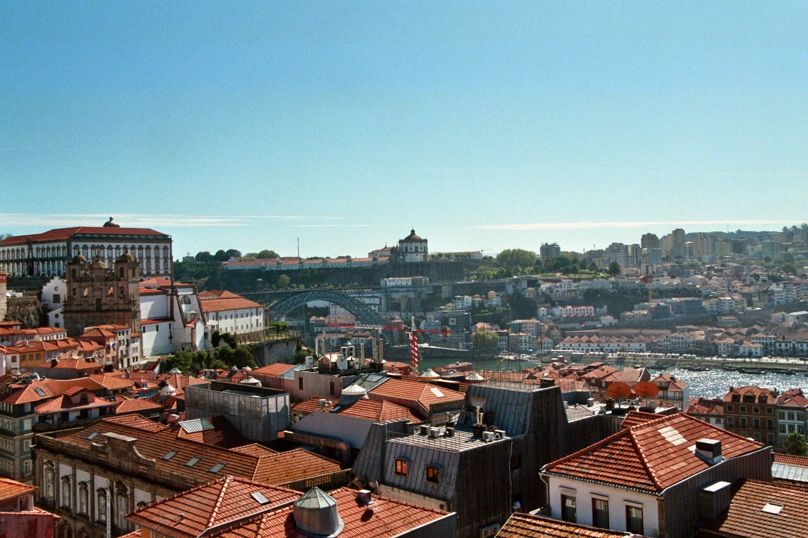
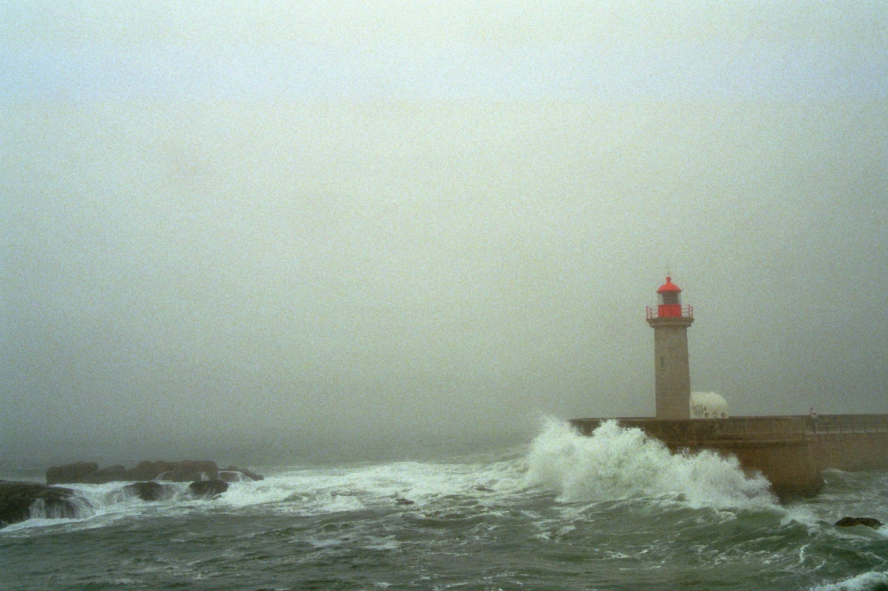
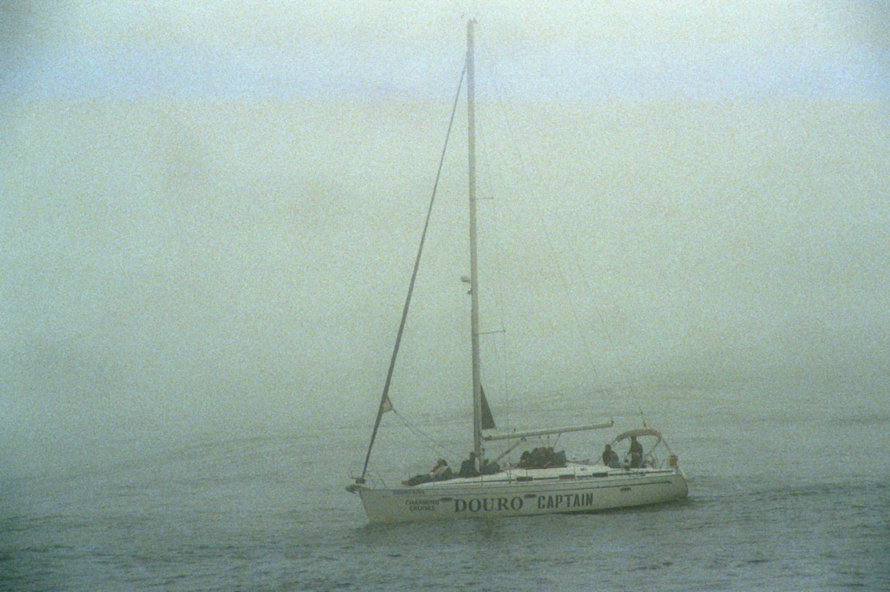
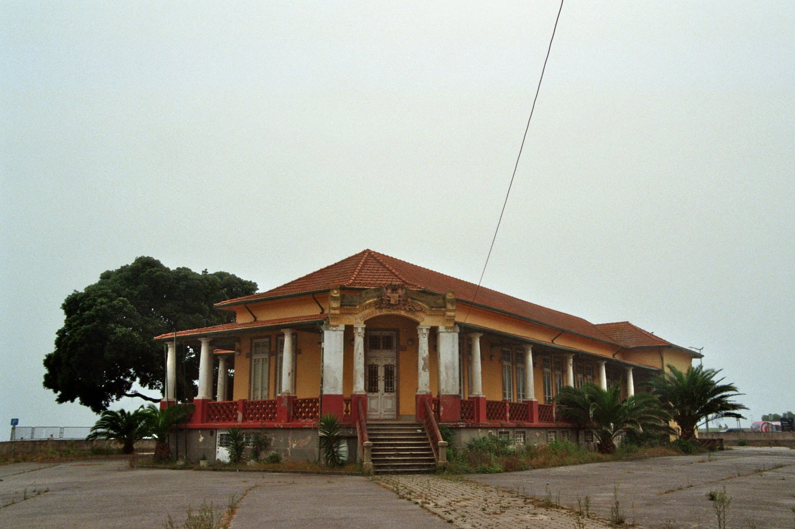
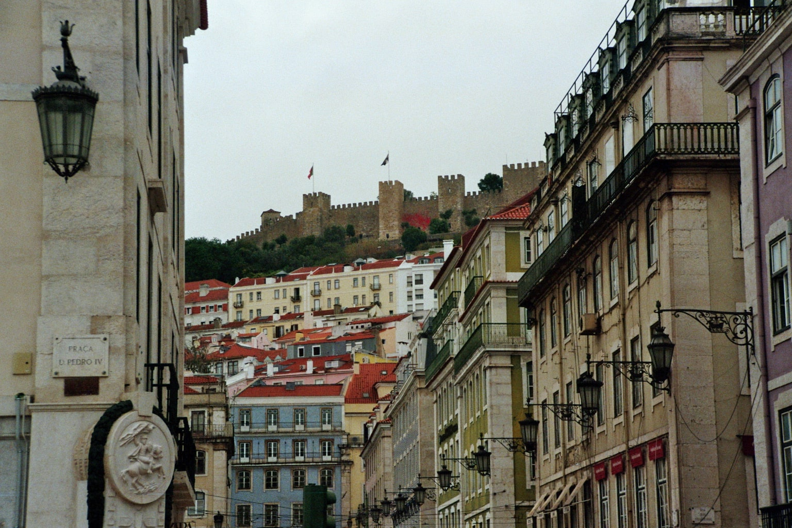
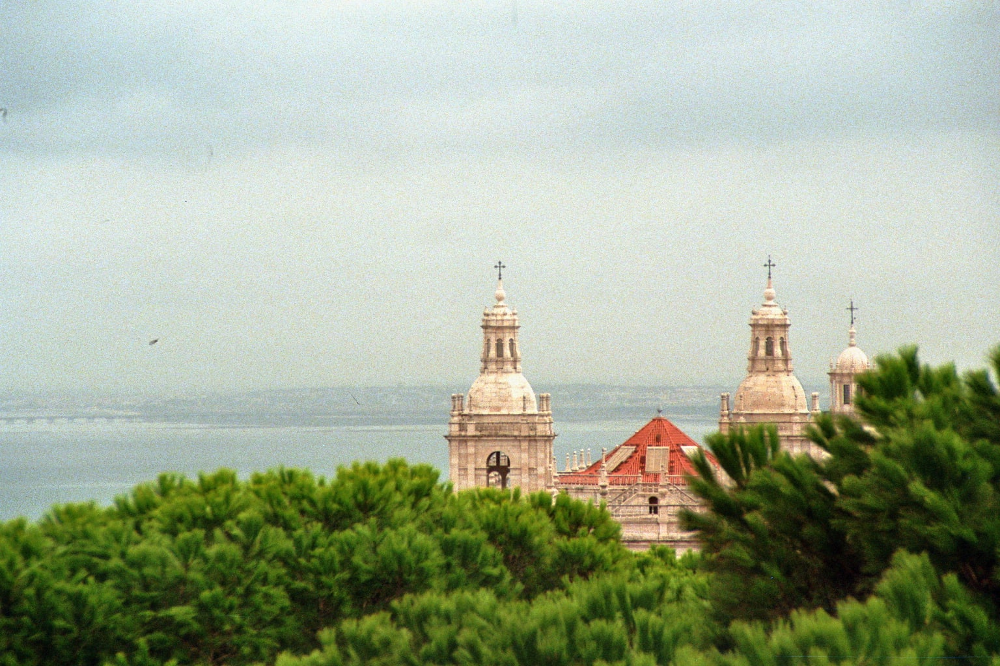
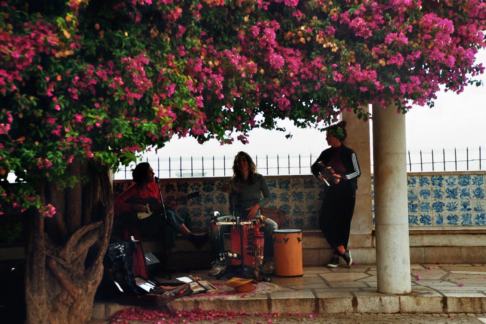
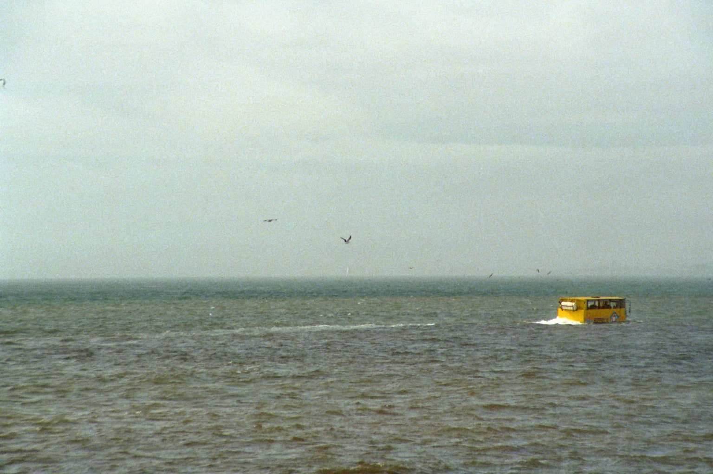

Here are some impressions from my first solo trip. It was a great experience and I loved to have my camera with me as that gave me something to do and focus on.
I feel like a camera can be a great companion on a solo trip, as it gives you a reason to stop and look at things more closely.
My trip started in Porto, Portugal. I really liked this city and especially the verticality of it, even if it was a bit exhausting to walk up and down all the time.
At night, it looked even more beautiful with all the lights and the reflections in the river.
Sadly, all of my night shots turned out blurry, as I didn't have a tripod with me and my overall experience with night photography is very limited.

The next day, just as I was making my way to the sea, the weather turned and it got very foggy. The experience however was very special: The fog got so dense as I walked up the pier, that the land behind me disappeared completely.
It was there where I took the photo of the lighthouse with the waves crashing against the pier and the sailboat returning from the sea.
All this made for quite the chilling atmosphere, but I was into it! Walking by an old, solitary building fitting this mood perfectly, I took a photo of it as well.

Lisbon was my next stop. Again, a very vertical city. I didn't like the city center that much as it was very crowded and touristy, but the castle up on the hill and its view over the city was worth the visit.
On my way back down I came across a group of musicians playing under a cherry tree. It was a beautiful scene, enhanced by their music and joyfulness.

My visit to Belém was again accompanied by the weather turning bad, but it wasn't as bad as in Porto. I obviously took a photo of the famous tower whilst being there.
However, I often feel like photos of famous landmarks can be a bit boring, as everyone essentially takes the same photo.
That's why I like to try to find new angles or capture random things that appear interesting to me in the moment, like this odd yellow ferry that was making its journey through the waves.

