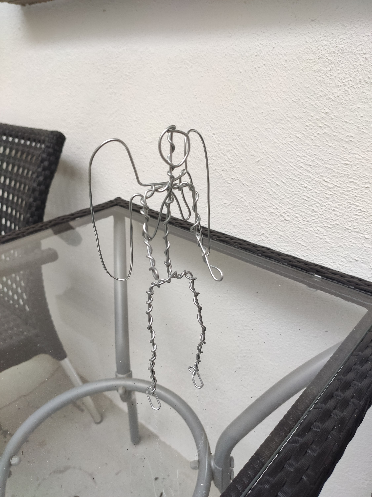
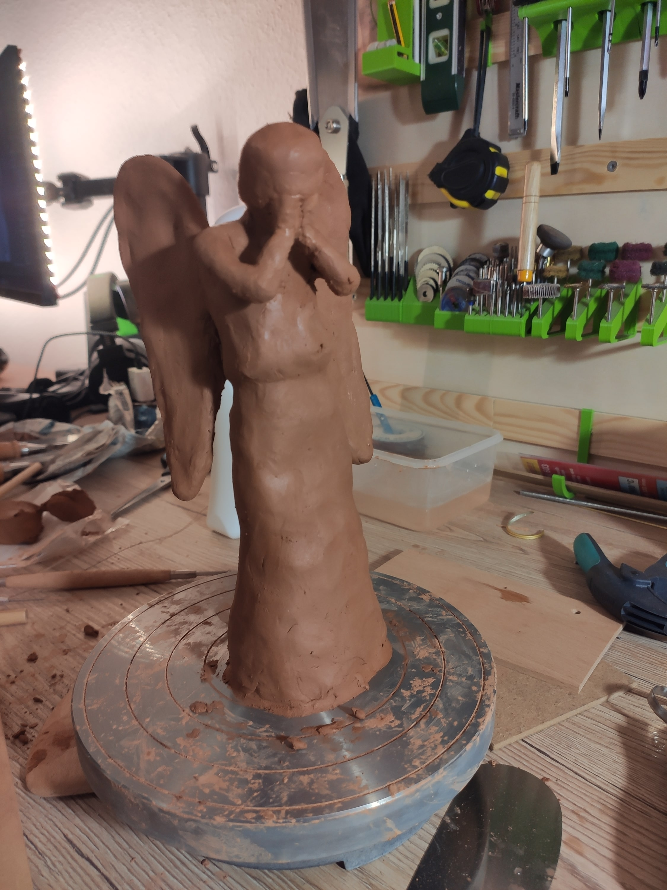
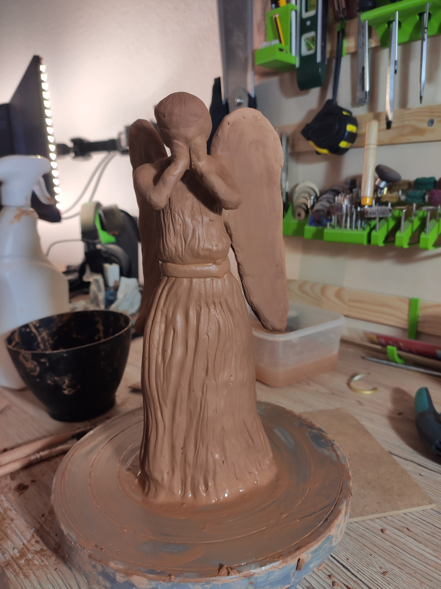
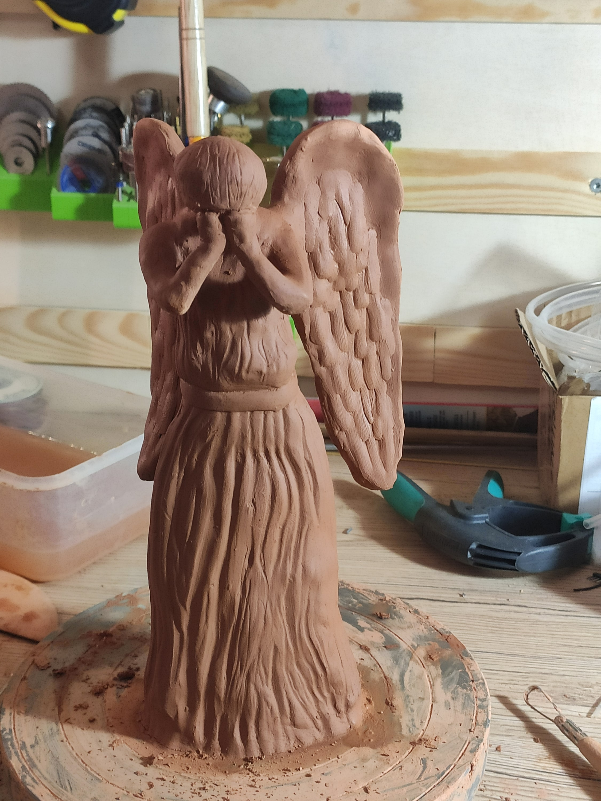
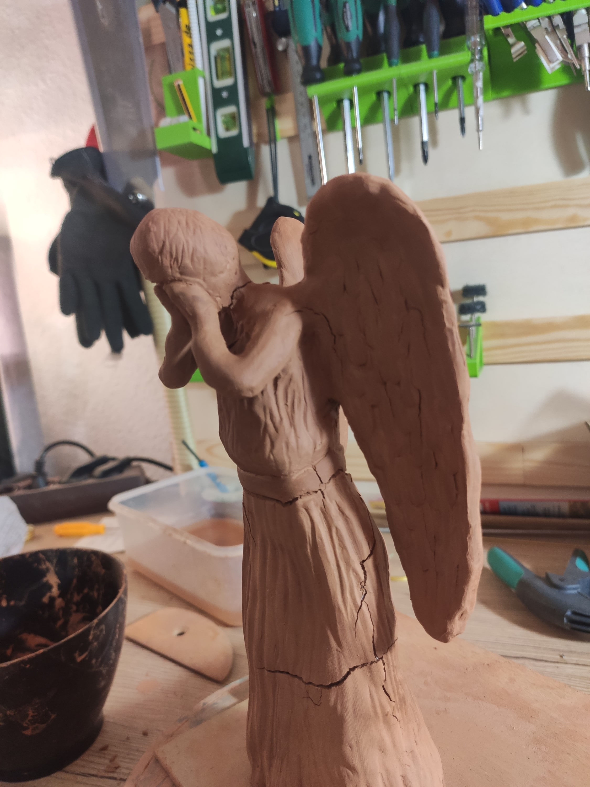
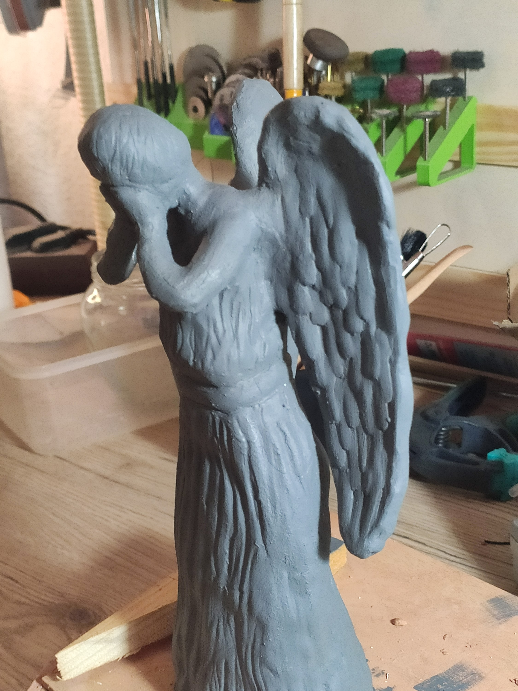

I created a small sculpture of a Weeping Angel from the TV show Doctor Who. It was my first time working with clay and for a first try I'm quite happy with the result.
Below you can see my progress from creating an armature over progressively adding details to the final sculpture.
In the fifth picture you can also see that I had quite some problems with cracks appearing whilst the clay dried.
This was probably due to the clay drying too fast and me adding some of the details too late.
Since I wasn't able to fix the cracks with clay and I didn't want to burn the sculpture anyways as well as planned to paint it with acrylics at the end, I decided to fill the cracks with some wall filler I had lying around.
Overall I learned a lot about working with clay through this project and I'm looking forward to working with it again in the future.

